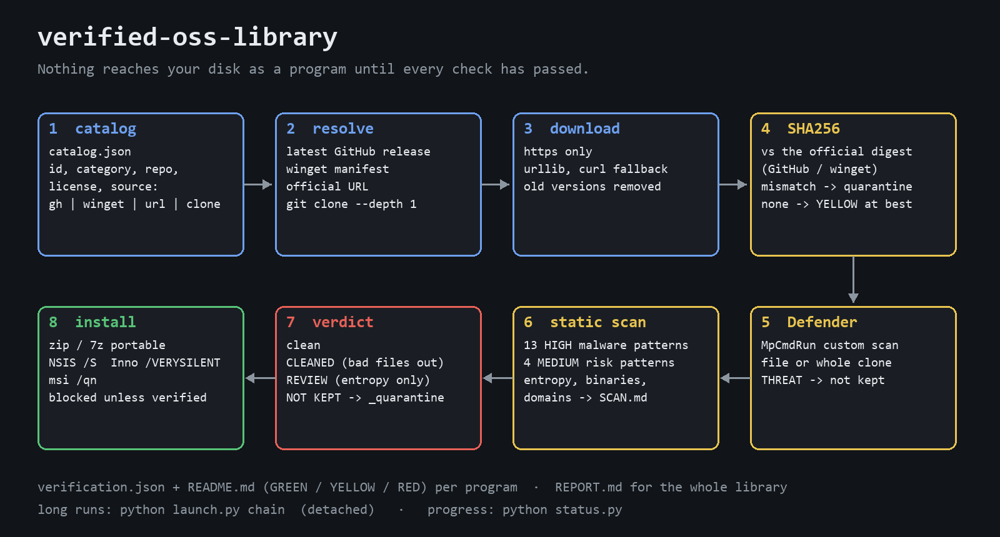

# verified-oss-library

**Keep a local library of open-source programs where nothing is installed until it has been verified.** A small set of Python command-line tools that fetch each program from its official source, check the SHA256 against the one the source publishes, scan it with Microsoft Defender and a static malware-pattern scanner, quarantine anything suspicious, and only then install it silently.



## Why

Most people install free software by searching for its name and clicking the first download button. That button is the weak link of the supply chain: lookalike domains, ad-funded mirrors, repackaged installers, a compromised release asset. A plugin repo with a `postinstall` script can read your browser's saved passwords just as easily as it can draw a bezier.

This tool turns "I trust it because the site looked official" into checks you can read afterwards:

- the binary comes from the **official release** (GitHub releases, the winget manifest, or a URL you wrote down yourself);
- its **SHA256 matches** the digest the source publishes — and when the source publishes none, the program is marked as such and can never reach GREEN;
- **Defender** has looked at it, and cloned code has been read by a **static scanner** for the patterns real malware uses;
- anything that fails goes to `_quarantine`, and `install.py` refuses to touch it.

Every decision lands in a `verification.json` per program, a README with a GREEN / YELLOW / RED level, and a `REPORT.md` for the whole library.

## Quickstart

Windows 10/11, Python 3.10+, the GitHub CLI (`gh`, logged in) for GitHub sources, `winget` for winget sources, `git` for clones. 7-Zip is optional (plain `.zip` files are extracted with the standard library).

```bash
cp catalog.example.json catalog.json        # then add your own programs
python fetch.py --only shotcut,lottie-web   # download, verify, scan
python readmes.py                           # README.md with a safety level per program
python install.py --only shotcut            # silent install of what passed
python status.py                            # done / failed / pending, running jobs
```

A whole catalog takes an hour or more. Run it detached so a closed terminal or an agent session does not hang on it:

```bash
python launch.py chain          # fetch -> analyze -> readmes -> report, in the background
python launch.py update         # same, asking every source for its latest version
python launch.py analyze --after 1234   # queue a job behind a running one
python status.py                # check progress at any time
```

### Where things go

Every path is configurable: environment variable first, then `config.json` (see `config.example.json`), then a default relative to this folder.

| Setting | Env variable | Default |
|---|---|---|
| downloads, clones, reports | `OSS_LIBRARY_ROOT` | `./library` |
| installs | `OSS_APPS_DIR` | `./apps` |
| catalog file(s) | `OSS_CATALOG` (several, separated by `;`) | `catalog.json`, else `catalog.example.json` |
| hand-written tips per program | `OSS_RECOMMENDATIONS` | `recommendations.json` (optional) |
| 7-Zip | `OSS_7Z` | `7z` on PATH, then Program Files |
| Defender CLI | `OSS_DEFENDER` | `MpCmdRun.exe` in its standard location |

### A catalog entry

```json
{"id": "shotcut", "name": "Shotcut", "category": "01_video_editing", "alternative_to": "Premiere, Final Cut",
 "repo": "mltframework/shotcut", "license": "GPL-3.0",
 "source": {"type": "gh", "repo": "mltframework/shotcut", "asset": "win64-.*\\.zip$"}, "notes": "Portable"}
```

`source.type` is `gh` (with `asset` regex, optional `tag` regex and `prerelease`), `winget` (with `id`), `url` (with `url` and, if you have it from the official site, `sha256`) or `clone`. `python probe_releases.py owner/repo` lists the Windows assets of the latest release, and whether GitHub publishes a digest for them, to help you write the `asset` regex.

## What each step checks

| Tool | What it does |
|---|---|
| `fetch.py` | Resolves the official source; downloads over **https only** (urllib, curl as fallback); compares the SHA256 with the official digest; runs Defender on the file or the whole clone; runs the static scanner on clones; applies the quarantine policy; deletes older versions; writes `verification.json` and `REPORT.md`. |
| `scanner.py` | 13 HIGH patterns that are almost never legitimate in a creative plugin (encoded PowerShell, base64 → exec, download-and-pipe-to-shell, Run-key or scheduled-task persistence, browser credential files, crypto wallets, webhook/Telegram exfiltration, reverse shells, keyloggers, antivirus tampering, long high-entropy lines) and 4 MEDIUM ones (running commands, `eval`, network calls, native libraries). Also lists bundled binaries and every domain the code mentions. Writes `SCAN.md`. |
| quarantine policy | SHA mismatch or a Defender threat: the whole entry goes to `_quarantine` and is not kept. A clone with HIGH findings: only the guilty files are moved out and the clone is rescanned (`CLEANED`); if only the entropy heuristic fired, it is kept as `REVIEW`. |
| `analyzer.py` | Languages, size, license file, entry points (npm `bin`/scripts, Python console scripts, loose plugin scripts), README summary, plus `semgrep` (security-audit + secrets), `pip-audit` and `npm audit` when they are installed. Writes `ANALYSIS.md`. |
| `readmes.py` | One README per program: what it replaces, license, source, version, and the safety level with its reasons. GREEN = official origin verified and nothing found; YELLOW = usable but with something to review; RED = do not use. |
| `install.py` | Refuses anything not verified. Extracts portables (with a zip-slip check), detects Inno Setup / NSIS / Squirrel installers and runs them silently into the apps folder, runs MSIs with `/qn`, and records everything in `INSTALLED.md`. |
| `launch.py` + `status.py` | Detached background jobs with a log per run, and an instant summary that never blocks. |

Scanner findings are leads, not verdicts: a MEDIUM finding is often perfectly normal code, and the scanner cannot see inside compiled binaries. Some of its own regexes spell words with a one-letter character class (`Meta[M]ask`) so that the scanner does not flag itself.

## Tests

```bash
pip install -r requirements-dev.txt
python -m pytest
```

The suite makes no network calls and installs nothing: downloads are `file://` URLs to fake local files, GitHub and winget answers are fixtures, `git clone` and Defender are replaced with monkeypatch. It covers SHA match and mismatch, the quarantine and cleaning policy, refusal of plain http, winget output in two languages, zip-slip, installer detection, safety levels, the status summary, the launcher's command chains and the analyzer. One test runs the scanner over this repository and expects zero HIGH findings.

## Built with AI-assisted workflows

Made by a motion and creative technologist working with AI agents. The library started as a way to let an agent fetch dozens of open-source creative tools without ever running an unverified binary on a working machine.

Licence: GPL-3.0-or-later (see `LICENSE`)

**Commercial licence.** If you want to use it in a closed product without the GPL obligations, a commercial licence is available: thejunglefruit@proton.me
